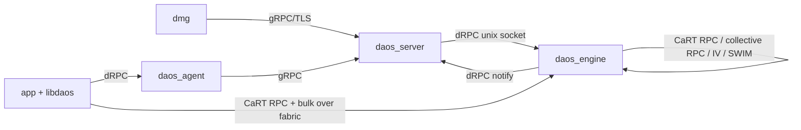
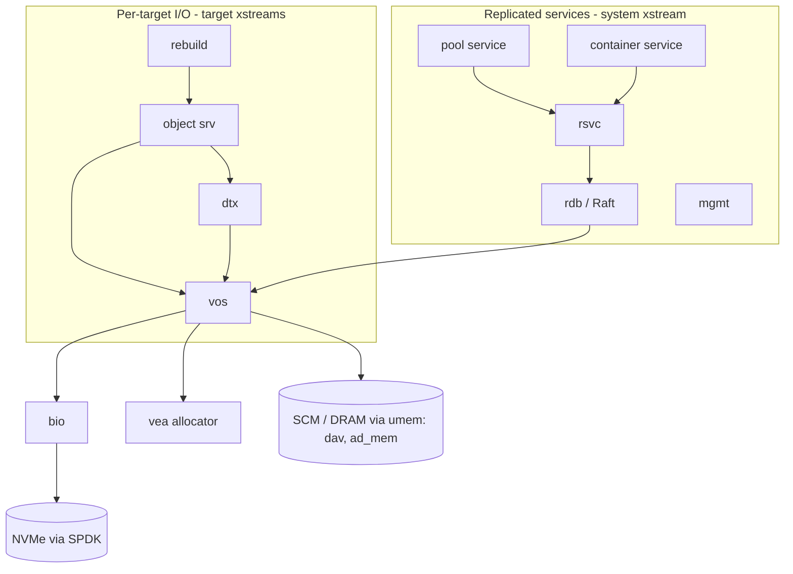

# DAOS architecture map

Longer prose: [src/README.md](../../src/README.md), [docs/overview/architecture.md](../overview/architecture.md),
[docs/overview/storage.md](../overview/storage.md), [docs/overview/transaction.md](../overview/transaction.md).

## Processes

| Process | Language | Source | Role |
|---|---|---|---|
| `daos_server` | Go | `src/control/cmd/daos_server` | Control plane: config, storage provisioning, starts and monitors engines, management service (MS) with its own Raft DB, gRPC server |
| `daos_engine` | C | `src/engine` | Data plane: one per socket/rank; loads the server modules (pool, cont, obj, dtx, rdb, ...), serves CaRT RPCs |
| `daos_agent` | Go | `src/control/cmd/daos_agent` | Client-node daemon: attach info and credential signing for libdaos via dRPC |
| `dmg` | Go | `src/control/cmd/dmg` | Admin CLI, talks gRPC to `daos_server` |
| `daos` | Go + cgo | `src/control/cmd/daos` | User CLI, uses libdaos |
| libdaos / libdfs | C | `src/client`, `src/object`, `src/pool`, `src/container` (`cli*.c`) | Client library linked into applications |
| `dfuse` | C | `src/client/dfuse` | FUSE daemon exposing DFS as a POSIX mount |

## Communication channels

- **gRPC**: protobuf definitions in `src/proto` (Go stubs under `src/control/common/proto`).
- **dRPC**: protobuf over Unix domain socket. Method IDs: `src/include/daos/drpc_modules.h`.
  Full method -> handler table: [generated/drpc.md](generated/drpc.md). Engine side dispatch:
  `src/mgmt/srv.c`; dRPC server runs as a ULT (`src/engine/drpc_listener.c`).
- **CaRT**: RPC/bulk/collective transport over Mercury (`src/cart`). Each module declares its
  opcodes in an X-macro list (e.g. `src/object/obj_rpc.h::OBJ_PROTO_CLI_RPC_LIST`). Full table:
  [generated/rpcs.md](generated/rpcs.md).

## Engine internals (`src/engine`)

- Entry: `src/engine/init.c::main` -> `src/engine/init.c::server_init` -> module load
  (`src/engine/module.c::dss_module_load`) and xstream setup (`src/engine/srv.c::dss_srv_init`).
- Modules register a `struct dss_module` (RPC handlers, init/setup, per-xstream keys). List:
  [generated/modules.md](generated/modules.md).
- Concurrency is Argobots: execution streams (xstreams, OS threads pinned to cores) run
  user-level threads (ULTs). `src/include/daos_srv/daos_engine.h::dss_xs_type`:
  - system xstreams: xs 0 (`DSS_XS_SYS`: pool service, rdb, dRPC handlers), SWIM, dRPC listener;
  - one main xstream per target (`DSS_XS_VOS`): owns that target's VOS pool, handles I/O RPCs;
  - optional helper/offload xstreams (`DSS_XS_IOFW`, `DSS_XS_OFFLOAD`) for I/O forwarding, EC,
    checksum.
- Create ULTs with `dss_ult_create()` or the scheduler-aware `sched_create_ult()`; offload to a
  helper with `dss_chore_register()`.
- CaRT RPCs are dispatched to the right xstream by `src/engine/srv.c::dss_rpc_hdlr`.

## Server-side layering

## Module index

Card = hand-written guide in [modules/](modules/). Dependencies are in
[generated/modules.md](generated/modules.md).

| Module | Side | What it is | Card |
|---|---|---|---|
| `src/gurt` | common | Utilities: logging (`D_*`), hash tables, lists, errno, telemetry | |
| `src/cart` | common | Collective And RPC Transport: RPC, bulk, collective RPCs, IV, SWIM | |
| `src/common` | common | btree, `pool_map.c`, checksums, ACLs, task scheduler `tse.c`, `dav`/`dav_v2`/`ad_mem` allocators | |
| `src/client` | client | Public APIs: `api` (daos_*), `array`, `kv`, `dfs`, `dfuse`, `pydaos`, `java`, `ds3` | |
| `src/placement` | both | Object layout algorithms (jump map, ring map): `pl_obj_place()` | |
| `src/object` | both | Object I/O client (`cli_*`) and server (`srv_*`), EC, migration | [object](modules/object.md) |
| `src/pool` | both | Pool client, pool service, pool map, per-target pool state | [pool](modules/pool.md) |
| `src/container` | both | Container client, container service, per-target container child, aggregation scheduling | |
| `src/dtx` | server | Distributed transactions (2PC, commit-on-share, resync) | [dtx](modules/dtx.md) |
| `src/vos` | server | Versioning Object Store: per-target MVCC persistent store | [vos](modules/vos.md) |
| `src/bio` | server | Blob I/O: NVMe via SPDK blobstore, SMD, WAL for MD-on-SSD | |
| `src/vea` | server | Versioned extent allocator for NVMe space | |
| `src/rdb` | server | Raft-replicated KV database | |
| `src/rsvc` | server | Replicated service framework on rdb (leader election, start/stop) | |
| `src/rebuild` | server | Data rebuild after target exclude / reintegration / extend | [rebuild](modules/rebuild.md) |
| `src/mgmt` | server | Engine-side management: dRPC handlers, target create/destroy | |
| `src/engine` | server | `daos_engine` main, xstreams/ULTs, module loader, dRPC server | [engine](modules/engine.md) |
| `src/security` | both | Credential validation, ACL enforcement | |
| `src/chk` | server | Catastrophic recovery checker (`dmg check`) | |
| `src/pipeline` | both | Server-side filter/aggregate pipeline API | |
| `src/control` | control | All Go: `daos_server`, `daos_agent`, `dmg`, `daos`, control API lib | [control](modules/control.md) |
| `src/proto` | control | Protobuf definitions for gRPC and dRPC | |
| `src/utils` | tools | `ddb`, `dlck`, `daos_metrics`, `self_test`, `crt_launch` | |
| `src/tests` | tests | `ftest` (Avocado functional), `suite` (`daos_test`), perf tools | |
