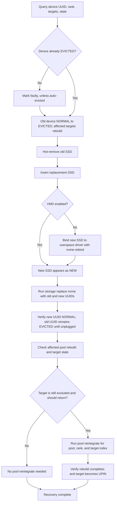
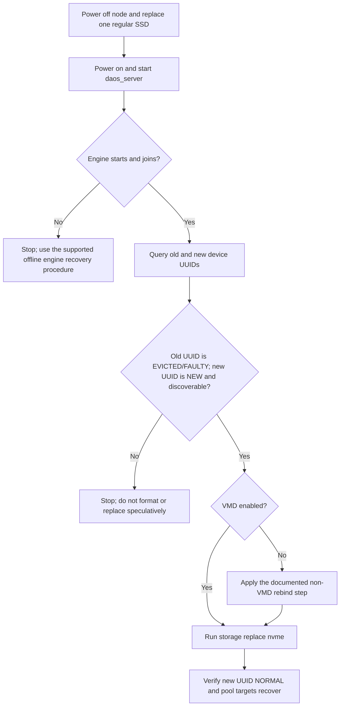
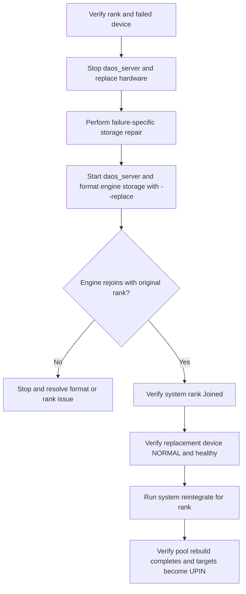

# Flow: replace a drive and verify recovery

This flow distinguishes device-level NVMe replacement from offline engine/rank storage recovery.
`dmg storage format --replace` is not a single-device replacement command: `--replace` reuses a
rank identity, and a format request can format all NVMe devices configured for an engine that
needs its superblock. Treat the engine's local pool data as lost and recover it through rebuild.
Device state and pool-target state are different: `dmg storage query list-devices` verifies the
device, while pool queries verify target membership and rebuild progress. See
[SSD management](../../admin/administration.md#ssd-management),
[pool reintegration](../../admin/pool_operations.md#reintegration), and the
[rebuild flow](rebuild.md).

## Online NVMe replacement

Use this path for a regular NVMe SSD that supports online hotplug. SysXS failures terminate the
engine and use the offline path below. The SSD management commands are dispatched through
`src/control/cmd/dmg/storage_query.go::nvmeReplaceCmd.Execute` and
`src/control/server/ctl_smd_rpc.go::singleDevSmdManage`.



1. Record the old device UUID, its rank, and target indices:

   ```bash
   dmg -l <host> storage query list-devices
   ```

   Before a fault, the old device is normally `NORMAL`. If it is already `EVICTED`, do not issue
   `set nvme-faulty` again. `dmg storage query list-devices --show-evicted` can list evicted
   devices only.
2. If the device has not already been evicted automatically, mark it faulty:

   ```bash
   dmg storage set nvme-faulty --host=<host> --uuid=<old-device-uuid>
   ```

   The device changes from `NORMAL` to `EVICTED`; DAOS starts the faulty-device reaction, which
   rebuilds the targets on that SSD. Check the old UUID with `dmg storage query list-devices`.
3. Hot-remove the old SSD and insert the replacement. The old device remains `EVICTED` until it
   is unplugged. The replacement is expected to appear as `NEW` before it is assigned for use.
   Query again to confirm both UUIDs and host/rank association.
4. If VMD is not enabled, bind the inserted SSD to a userspace driver, then replace the device:

   ```bash
   dmg storage nvme-rebind -a <new-device-pci-address> -l <host>
   dmg storage replace nvme --host=<host> \
     --old-uuid=<old-device-uuid> --new-uuid=<new-device-uuid>
   ```

   On success, the new device transitions `NEW` -> `NORMAL`; the old device remains `EVICTED`
   until physically unplugged. Verify device state and health:

   ```bash
   dmg -l <host> storage query list-devices --health
   ```

   The new UUID should be `NORMAL` and show the expected rank and target IDs. The old UUID should
   be absent after unplugging (or remain `EVICTED` if still present).
5. Verify storage and pool recovery separately:

   ```bash
   dmg -l <host> storage query list-pools --uuid=<pool-uuid> --verbose
   dmg pool query <pool-uuid>
   ```

   `list-pools` shows the pool-to-rank/target association; `pool query` reports pool target and
   rebuild status. A `NORMAL` device alone does not prove that a pool target has returned to the
   healthy `UPIN` state. If a target remains excluded and should return to this pool, reintegrate
   only the affected target(s):

   ```bash
   dmg pool reintegrate <pool-uuid> --ranks=<rank> --target-idx=<target-index-list>
   ```

   Verify rebuild completion and that the target is `UPIN` in the pool map. Do not use
   `dmg system reintegrate` for a device-only hot replacement unless the whole rank needs to be
   returned to all of its pools.

## Single-drive swap while the node is powered off

A powered-off swap is not the same event sequence as a live hotplug. A post-boot
`dmg storage replace nvme` is only viable if the engine starts and can see both the old device's
fault record and the new device. `bio_replace_dev()` requires the old SMD device to be `FAULTY`,
its blobstore to be out of service, and the new UUID to be discoverable but not already in SMD.
See `src/bio/bio_device.c::bio_replace_dev` and
`src/bio/bio_device.c::replace_dev`.



1. After starting `daos_server`, verify rank membership and inspect device states:

   ```bash
   dmg system query -v
   dmg -l <host> storage query list-devices
   ```

   Continue only if the engine is available and the state is suitable for device replacement: the
   old UUID must remain in SMD as faulty/evicted and the new UUID must be visible as an unassigned
   device (`NEW`). The device-replace handler also requires the old blobstore to be out of service.
2. If VMD is disabled, use the documented rebind step to expose the new SSD to DAOS:

   ```bash
   dmg storage nvme-rebind -a <new-device-pci-address> -l <host>
   ```

   Local documentation notes that full non-VMD hotplug capability is not production-supported in
   the described release; confirm support for the deployed DAOS version and platform before using
   this path. See `src/bio/README.md`.
3. If the engine can discover both devices in the required states, issue the device-level replace:

   ```bash
   dmg storage replace nvme --host=<host> \
     --old-uuid=<old-device-uuid> --new-uuid=<new-device-uuid>
   ```

   Verify the new device is `NORMAL` and check each affected pool with `dmg pool query` until
   rebuild/reintegration completes and the targets are healthy (`UPIN`). Device replacement
   triggers automatic reintegration in the normal hotplug path, but the code notes a restart can
   miss that automatic trigger. If targets remain excluded, handle their pool reintegration
   explicitly and verify completion.

Do not run `dmg storage format --replace` as a substitute for replacing a single SSD. That command
is for engine/rank storage recovery, and `--replace` selects rank identity rather than a device.
If the engine cannot start or the required SMD state is unavailable, stop and follow the
failure-specific offline recovery procedure; do not infer that formatting is safe for the other
drives or their pool data.

## Offline engine or rank recovery

Use the device-level `dmg storage replace nvme` path when the engine is available and the device
replacement procedure is supported. It replaces the SMD device mapping and is the specific
single-device operation. The documented procedure assumes online hotplug; do not assume it applies
to a powered-off swap unless the platform's recovery procedure supports it.

The following offline procedure is for engine/rank storage recovery when formatting is required,
such as a SysXS failure or loss of engine metadata. It is not a way to ask DAOS to replace only one
NVMe device. The `--replace` option preserves the old rank identity; it does not limit formatting to
the failed device. When the engine needs a new superblock, `formatEngineBdevs()` formats the NVMe
tiers configured for that engine. Local data on those devices, including healthy devices in the same
engine, must be treated as lost and reconstructed by rebuild. Preserve metadata for other engines
on a multi-engine host. See `src/control/server/instance_storage_rpc.go::formatEngineBdevs`.



1. Verify the affected rank and device before stopping the server:

   ```bash
   dmg system query -v
   dmg -l <host> storage query list-devices
   ```

   The engine/rank may be `Errored` or `Excluded`; the device query identifies the failed device,
   its role, and whether it is `EVICTED` or `UNPLUGGED`.
2. Stop `daos_server`, replace the device, and perform the failure-specific repair. For documented
   SysXS recovery, remove only the failed engine's superblock as described in
   [SysXS device failure recovery](../../admin/administration.md#sysxs-device-failure-recovery).
3. Restart `daos_server`, then format the recovered engine using its prior rank. This can reset
   every NVMe device configured for that engine, not just the failed SSD; only proceed when this
   broader data loss and rebuild are intended:

   ```bash
   dmg storage format --replace -l <host>
   ```

   `--replace` preserves the old rank identity; it is not a device selector. Before format
   completes, the new device may be `NEW`. After format, verify the expected devices are `NORMAL`
   and healthy, and verify that the engine joined with the original rank:

   ```bash
   dmg system query -v
   dmg -l <host> storage query list-devices --health
   ```

4. Reintegrate the returned rank into all pools and verify the resulting rebuild:

   ```bash
   dmg system reintegrate --ranks=<rank>
   dmg pool query <pool-uuid>
   ```

   The pool targets transition through `UP` while reintegration/rebuild is pending and become
   `UPIN` when healthy. Confirm rebuild completion for every affected pool.