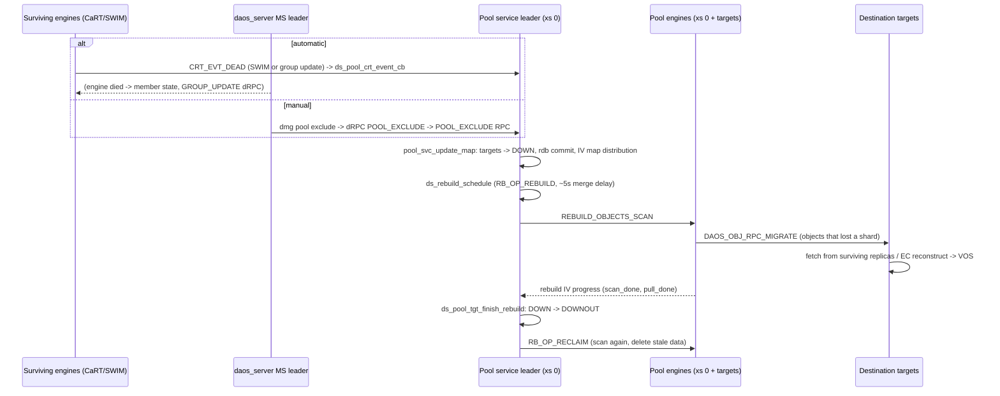

# Flow: target failure -> exclude -> rebuild -> reclaim

Scenario: an engine (rank) dies, or an admin runs `dmg pool exclude`. The pool service excludes
the rank's targets, and the remaining engines restore redundancy. Module details:
[rebuild](../modules/rebuild.md), [pool](../modules/pool.md), [object](../modules/object.md),
[control](../modules/control.md).

## 1. Failure is noticed

Automatic path (no admin action):

1. SWIM in every engine (`src/cart/swim`) marks the dead rank; CaRT raises a `CRT_EVT_DEAD` event.
   Separately, `daos_server` sees the engine process exit
   (`src/control/server/instance_exec.go::EngineInstance.handleExit`, RAS `RASEngineDied`), the MS
   updates the member state (`src/control/system/membership.go::Membership.OnEvent`), and MS group
   updates (`src/control/server/mgmt_system.go::mgmtSvc.doGroupUpdate`, dRPC
   `DRPC_METHOD_MGMT_GROUP_UPDATE`) remove the rank from the engines' primary group, which also
   surfaces as a dead event (`CRT_EVS_GRPMOD`).
2. On the pool service leader, `src/pool/srv_pool.c::ds_pool_crt_event_cb` -> `queue_event()`;
   the `src/pool/srv_pool.c::events_handler` ULT -> `src/pool/srv_pool.c::handle_event` ->
   `src/pool/srv_pool.c::pool_svc_exclude_ranks` builds the rank list and calls
   `pool_svc_update_map()` with `MAP_EXCLUDE` and source `MUS_SWIM`.

Manual path:

1. `dmg pool exclude` -> `src/control/server/mgmt_pool.go::mgmtSvc.PoolExclude` -> dRPC
   `DRPC_METHOD_MGMT_POOL_EXCLUDE` -> `src/mgmt/srv_drpc.c::ds_mgmt_drpc_pool_exclude` ->
   `src/mgmt/srv_pool.c::ds_mgmt_pool_target_update_state` ->
   `src/pool/srv_cli.c::dsc_pool_svc_update_target_state` (POOL_EXCLUDE RPC to the leader).
2. `src/pool/srv_pool.c::ds_pool_update_handler` -> `pool_update_handler()` ->
   `pool_svc_update_map()`. Drain (`PO_COMP_ST_DRAIN`) and reintegrate (`PO_COMP_ST_UP`) take
   the same route with a different target state.

## 2. Pool map update (pool service leader, xs 0)

3. `src/pool/srv_pool.c::pool_svc_update_map` -> `src/pool/srv_pool.c::pool_svc_update_map_internal`:
   - for SWIM-sourced excludes, checks the pool property `DAOS_SELF_HEAL_AUTO_EXCLUDE` and the
     system self-heal property (`DS_MGMT_SELF_HEAL_POOL_EXCLUDE`); if disabled nothing changes;
   - `src/pool/srv_pool_map.c::ds_pool_map_tgts_update` moves targets to `DOWN` and bumps the map
     version; written in an rdb transaction (`rdb_tx_commit()`);
   - `ds_rsvc_request_map_dist()` -> `src/pool/srv_pool.c::pool_svc_map_dist_cb` ->
     `ds_pool_iv_map_update()` distributes the new map to all engines. Clients learn it lazily
     (I/O with an old map version gets `-DER_STALE`, see [write-path.md](write-path.md)).
4. Still in `pool_svc_update_map`: rebuild is skipped if `DAOS_REBUILD=no`, if the system
   self-heal disables pool rebuild for automatic events, or if
   `src/include/daos_srv/pool.h::is_pool_rebuild_allowed` says no (pool `self_heal` lacks
   `AUTO_REBUILD`/`DELAY_REBUILD` for automatic events, or rebuild was stopped by an admin).
   Otherwise `src/rebuild/srv.c::ds_rebuild_schedule` queues an `RB_OP_REBUILD` task, with a
   5 s delay for exclude/drain/reint so multi-rank failures merge into one rebuild
   (`DAOS_SELF_HEAL_DELAY_REBUILD` defers it until an admin starts it).

## 3. Rebuild (see [modules/rebuild.md](../modules/rebuild.md) for every hop)

5. Leader: `src/rebuild/srv.c::rebuild_ults` -> `src/rebuild/srv.c::rebuild_task_ult` ->
   `src/rebuild/srv.c::rebuild_leader_start` -> `src/rebuild/srv.c::rebuild_scan_broadcast`
   (collective `REBUILD_OBJECTS_SCAN`).
6. Every engine: `src/rebuild/scan.c::rebuild_tgt_scan_handler` -> `rebuild_scan_leader()` waits
   for DTX resync, then `src/rebuild/scan.c::rebuild_scanner` on every target walks local objects
   and asks placement (`src/placement/pl_map.c::pl_obj_find_rebuild`) which shards were on the
   `DOWN` targets and where they now go.
7. Scanner sends object lists: `src/object/srv_obj_migrate.c::ds_object_migrate_send`
   (`DAOS_OBJ_RPC_MIGRATE`).
8. Destination: `src/object/srv_obj_migrate.c::ds_obj_migrate_handler` -> `ds_migrate_object()` ->
   `migrate_one_ult()` -> `src/object/srv_obj_migrate.c::migrate_dkey`: reads the data from
   surviving shards with `dsc_obj_fetch()` (EC: reconstructs data/parity) and writes it with
   `vos_obj_update()`.
9. Progress flows back via rebuild IV (`src/rebuild/rebuild_iv.c::rebuild_iv_update` ->
   `src/rebuild/srv.c::rebuild_global_status_update` on the leader); `dmg pool query` shows it
   through `src/rebuild/srv.c::ds_rebuild_query`.

## 4. Completion

10. `rebuild_task_ult` -> `src/pool/srv_pool.c::ds_pool_tgt_finish_rebuild`: `DOWN` -> `DOWNOUT`
    (map version bump, distributed again).
11. `src/rebuild/srv.c::rebuild_task_complete_schedule` queues `RB_OP_RECLAIM`, which re-scans and
    removes data that no longer belongs on each target. On failure it calls
    `src/rebuild/srv.c::retry_rebuild_task` and may queue `RB_OP_FAIL_RECLAIM` before retrying.

## Variations

- **Drain**: targets go `DRAIN` (still in the map) while their shards are copied to other
  targets; finish moves them to `DOWNOUT`.
- **Reintegrate**: `ds_mgmt_pool_target_update_state()` first recreates the target's VOS files
  (`ds_mgmt_tgt_pool_create_ranks()`), targets go `UP`; rebuild copies data back; finish moves them
  to `UPIN`; reclaim deletes stale copies elsewhere. Reintegration mode
  `DAOS_REINT_MODE_NO_DATA_SYNC` skips data movement.
- **Extend**: `dmg pool extend` -> `src/pool/srv_pool.c::ds_pool_extend_handler` adds targets,
  which move `NEW` -> `UP` (`MAP_EXTEND` in `src/pool/srv_pool_map.c`); rebuild moves the shards
  whose placement changed; finish moves them to `UPIN`.
- State transitions for every map op are in `src/pool/srv_pool_map.c::ds_pool_map_tgts_update`.
- **Admin control**: `dmg pool rebuild stop|start` -> `ds_rebuild_admin_stop()` /
  `ds_rebuild_admin_start()`.
