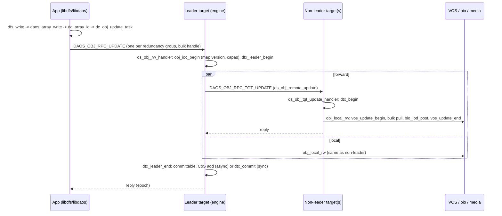

# Flow: DFS write down to media

Scenario: an application calls `dfs_write()` on a file whose object class is replicated (RP_*) or
erasure coded (EC_*). Modules: [object](../modules/object.md), [dtx](../modules/dtx.md),
[vos](../modules/vos.md).

## Client side (`libdaos`, application threads + TSE scheduler)

1. `src/client/dfs/io.c::dfs_write`: builds a `daos_array_iod_t` (offset/length) and calls
   `daos_array_write()`.
2. `src/client/api/array.c::daos_array_write`: creates a task running `dc_array_write()`.
3. `src/client/array/dc_array.c::dc_array_write` -> `src/client/array/dc_array.c::dc_array_io`:
   maps byte ranges to array chunks (one dkey per chunk) and creates `DAOS_OPC_OBJ_UPDATE`
   sub-tasks with `daos_task_create()`.
4. Opcode table `src/client/api/init.c` maps `DAOS_OPC_OBJ_UPDATE` to
   `src/object/cli_obj.c::dc_obj_update_task` (also reachable directly from
   `src/client/api/object.c::daos_obj_update`).
5. `src/object/cli_obj.c::dc_obj_update`: checks map version, selects the redundancy group for
   the dkey hash (`src/object/cli_obj.c::obj_update_shards_get`), EC reassembly if needed
   (`src/object/cli_ec.c`), creates bulk handles for large payloads
   (`src/object/cli_obj.c::obj_rw_bulk_prep`).
6. `src/object/cli_obj.c::obj_req_fanout`: with server-side dispatch (`ort_srv_disp`, the default
   when group size > 1) sends **one RPC per redundancy group to the DTX leader shard**.
7. `src/object/cli_shard.c::dc_obj_shard_rw`: fills `obj_rw_in` (oid, dkey, iods, epoch,
   `orw_map_ver`, DTX id, bulks) and sends `DAOS_OBJ_RPC_UPDATE`.

## Leader target (`daos_engine`, target main xstream)

8. `src/engine/srv.c::dss_rpc_hdlr` queues the RPC to the target xstream's scheduler.
9. `src/object/srv_obj.c::ds_obj_rw_handler`: `src/object/srv_obj.c::obj_ioc_begin` validates
   pool/container handles, capabilities and pool map version (`-DER_STALE` on mismatch); resend
   check (`dtx_handle_resend()`); then `src/dtx/dtx_common.c::dtx_leader_begin`.
10. `src/dtx/dtx_common.c::dtx_leader_exec_ops` runs `src/object/srv_obj.c::obj_tgt_update` for
    every participant:
    - remote shards: `src/object/srv_obj_remote.c::ds_obj_remote_update` sends
      `DAOS_OBJ_RPC_TGT_UPDATE` (dispatched as a `dss_chore`);
    - local shard (`idx == -1`): `src/object/srv_obj.c::obj_local_rw`.
11. `src/dtx/dtx_common.c::dtx_leader_end`: on success marks the DTX committable and either commits
    synchronously (`dtx_commit()`) or adds it to the CoS cache (`dtx_cos_add()`) for batched
    commit by `dtx_batched_commit`; on failure `dtx_abort()`. Replies to the client.

## Non-leader targets

12. `src/object/srv_obj.c::ds_obj_tgt_update_handler`: `src/dtx/dtx_common.c::dtx_begin`, then
    `obj_local_rw()`, then `src/dtx/dtx_common.c::dtx_end` (entry stays *prepared* until the
    leader commits).

## Local I/O (any target, target main xstream)

13. `src/object/srv_obj.c::obj_local_rw` -> `src/object/srv_obj.c::obj_local_rw_internal_wrap` ->
    `src/object/srv_obj.c::obj_local_rw_internal`:
    - checksum verification (`src/object/srv_csum.c`) and EC filtering;
    - `src/vos/vos_io.c::vos_update_begin`: resolves the object/dkey/akey trees, checks DTX/MVCC
      conflicts, **reserves** space: SCM via `src/vos/vos_io.c::vos_reserve_scm`, NVMe via
      `src/vos/vos_io.c::vos_reserve_blocks` -> `src/vea/vea_api.c::vea_reserve`;
    - `src/bio/bio_buffer.c::bio_iod_prep`: maps the reserved extents to DMA buffers;
    - `src/object/srv_obj.c::obj_bulk_transfer`: RDMA-pulls client data into those buffers
      (inline data is copied with `bio_iod_copy()`);
    - `src/bio/bio_buffer.c::bio_iod_post` / `bio_iod_post_async`: writes NVMe data via SPDK;
    - `src/vos/vos_io.c::vos_update_end`: within one VOS/umem transaction
      (`src/vos/vos_common.c::vos_tx_begin` ... `src/vos/vos_common.c::vos_tx_end`) publishes the
      reservations, inserts records into SV/EV trees, updates ilogs and registers each record with
      the DTX entry (`src/vos/vos_dtx.c::vos_dtx_register_record`). The DTX entry itself is
      attached in DRAM by `dtx_begin()`/`dtx_leader_begin()` and persisted by
      `dtx_end()`/`dtx_leader_end()` (both via `src/vos/vos_dtx.c::vos_dtx_attach`).

## Branches worth knowing

- **Solo DTX** (single-replica object class): no forwarding; DTX is validated inside VOS.
- **EC**: client splits stripes into data + parity per shard; partial-stripe updates are
  replicated to parity shards and later folded by EC aggregation (`src/object/srv_ec_aggregate.c`).
- **Small values** stay in SCM; larger array extents go to NVMe (media selection in `vos_io.c`).
- **Errors**: `-DER_STALE` (refresh pool map, retry), `-DER_INPROGRESS` (conflicting prepared
  DTX; server tries `dtx_refresh()` first), `-DER_TX_RESTART` (MVCC conflict, restart with new
  epoch). Client retry logic: `src/object/cli_obj.c::obj_retry_cb`.

## Related reads (fetch path mirror)

`dc_obj_fetch_task()` -> `ds_obj_rw_handler()` (fetch path: local `dtx_begin()` only, no
forwarding) -> `obj_local_rw()` -> `vos_fetch_begin()` -> `bio_iod_prep()` -> bulk PUT ->
`vos_fetch_end()`.
