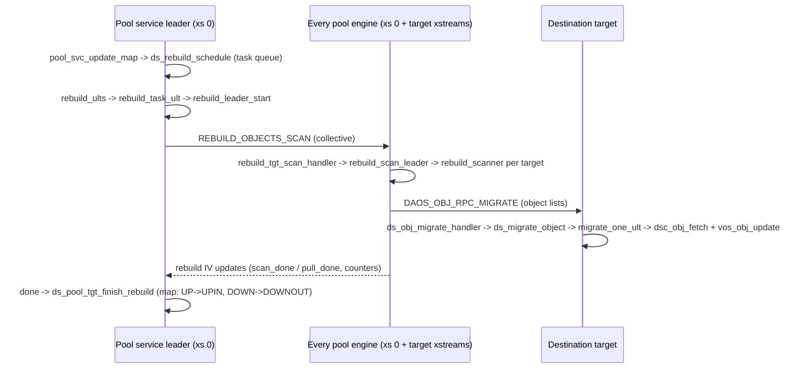

# Rebuild (`src/rebuild` + `src/object/srv_obj_migrate.c`)

Design: [src/rebuild/README.md](../../../src/rebuild/README.md),
[src/rebuild/rebuild_design.md](../../../src/rebuild/rebuild_design.md). Server API:
`src/include/daos_srv/rebuild.h`.

## Purpose

Restores redundancy and moves data whenever the pool map changes: a target is excluded (failure),
drained, reintegrated, or added (extend), and on layout upgrade. Rebuild is driven by the pool
service leader and executed by every engine of the pool in two phases: **scan** (each target
walks its local objects and works out which shards must exist elsewhere under the new map) and
**pull/migrate** (destination targets fetch the data from surviving replicas, or reconstruct it
from EC, and write it into their VOS).

## Operations (`src/include/daos_srv/rebuild.h::daos_rebuild_opc_t`)

| Op | Used for |
|---|---|
| `RB_OP_REBUILD` | All pool-map driven data movement: exclude, drain, reintegrate, extend. The target states in the map (DOWN, DRAIN, UP, NEW) decide what each scan looks for |
| `RB_OP_RECLAIM` | Scheduled after every successful `RB_OP_REBUILD`/`RB_OP_UPGRADE`: delete data that no longer belongs on a target under the new layout |
| `RB_OP_FAIL_RECLAIM` | After a failed rebuild: discard partially rebuilt data above the reclaim epoch |
| `RB_OP_UPGRADE` | Object layout upgrade after a pool upgrade |

## File map

| File | Role |
|---|---|
| `src/rebuild/srv.c` | Module (`rebuild_module`), task queue (`ds_rebuild_schedule`, `rebuild_ults`), leader (`rebuild_task_ult`, `rebuild_leader_start`, `rebuild_scan_broadcast`, `rebuild_leader_status_check`), target status ULT, admin start/stop, query |
| `src/rebuild/scan.c` | `REBUILD_OBJECTS_SCAN` handler (`rebuild_tgt_scan_handler`), per-target scanner, sending object lists to destinations |
| `src/rebuild/rebuild_iv.c` | Rebuild IV: targets report progress to the leader |
| `src/rebuild/rpc.c`, `src/rebuild/rpc.h` | RPC formats (`REBUILD_PROTO_SRV_RPC_LIST`) |
| `src/rebuild/rebuild_internal.h` | Trackers, task, global state |
| `src/rebuild/ras.c` | RAS events for rebuild |
| `src/object/srv_obj_migrate.c` | Migration engine: receive object lists, fetch + write data |

## Flow

End-to-end, including failure detection and the pool map update that triggers rebuild:
[flows/rebuild.md](../flows/rebuild.md).

1. Trigger: `src/pool/srv_pool.c::pool_svc_update_map` (exclude/drain/reint/extend) calls
   `src/rebuild/srv.c::ds_rebuild_schedule` with `RB_OP_REBUILD` and a short delay to merge
   multi-rank events; `DAOS_SELF_HEAL_DELAY_REBUILD` defers it, and reintegration mode
   `DAOS_REINT_MODE_NO_DATA_SYNC` skips data movement.
2. Queue: tasks for the same pool/op are merged; `src/rebuild/srv.c::rebuild_ults` (one ULT, on the
   pool-service xstream) starts `src/rebuild/srv.c::rebuild_task_ult` per task.
3. Leader: `src/rebuild/srv.c::rebuild_leader_start` creates the global tracker and
   `src/rebuild/srv.c::rebuild_scan_broadcast` sends collective `REBUILD_OBJECTS_SCAN`.
4. Every engine: `src/rebuild/scan.c::rebuild_tgt_scan_handler` -> `src/rebuild/srv.c::rebuild_tgt_prepare`
   (target tracker, IV) and starts `src/rebuild/scan.c::rebuild_scan_leader` and
   `src/rebuild/srv.c::rebuild_tgt_status_check_ult`.
5. `rebuild_scan_leader` waits for the global DTX resync version, calls `dtx_cleanup_orphan()`,
   then `ds_pool_thread_collective()` runs `src/rebuild/scan.c::rebuild_scanner` on each target
   xstream: `vos_iterate()` over containers (`rebuild_container_scan_cb`) and objects
   (`src/rebuild/scan.c::rebuild_obj_scan_cb`), `src/rebuild/scan.c::find_rebuild_shards`
   (placement: `pl_obj_find_rebuild()`) and `rebuild_object_insert()`.
6. `src/rebuild/scan.c::rebuild_objects_send_ult` -> `src/object/srv_obj_migrate.c::ds_object_migrate_send`
   sends `DAOS_OBJ_RPC_MIGRATE` to the destination.
7. Destination: `src/object/srv_obj_migrate.c::ds_obj_migrate_handler` ->
   `src/object/srv_obj_migrate.c::ds_migrate_object` (per-target ULTs, `migrate_obj_iter_cb`) ->
   `src/object/srv_obj_migrate.c::migrate_one_ult` -> `src/object/srv_obj_migrate.c::migrate_dkey`,
   which reads from surviving shards with `dsc_obj_fetch()` (or rebuilds EC data/parity:
   `migrate_fetch_update_parity()`) and writes locally (`vos_obj_update()`,
   `src/object/srv_obj_migrate.c::migrate_one_insert_recx`).
8. Progress: target status ULT pushes counters and `scan_done`/`pull_done` through
   `src/rebuild/rebuild_iv.c::rebuild_iv_update`; on the leader the IV callback calls
   `src/rebuild/srv.c::rebuild_global_status_update`.
9. Completion: `rebuild_task_ult` calls `src/pool/srv_pool.c::ds_pool_tgt_finish_rebuild` to update
   target states; `src/rebuild/srv.c::rebuild_task_complete_schedule` then queues `RB_OP_RECLAIM`
   on success, or on failure uses `src/rebuild/srv.c::retry_rebuild_task` to decide on a retry
   (possibly after `RB_OP_FAIL_RECLAIM`); `ds_pool_tgt_revert_rebuild()` reverts map changes.

## Key structures (`src/rebuild/rebuild_internal.h`)

- `src/rebuild/rebuild_internal.h::rebuild_task`: queued task (pool, map version, op, targets,
  reclaim epoch, schedule time).
- `src/rebuild/rebuild_internal.h::rebuild_global_pool_tracker`: leader-side per-pool state
  (per-rank status, DTX resync version, stable epoch, abort flags).
- `src/rebuild/rebuild_internal.h::rebuild_tgt_pool_tracker`: per-engine per-pool state (object
  trees to send, counters, leader term).
- `src/object/srv_internal.h::migrate_pool_tls`: per-target migration state.
- `src/object/srv_obj_migrate.c::migrate_one`: one dkey/object migration unit.

## Threading

- Pool-service xstream (xs 0) of the leader: `rebuild_ults`, `rebuild_task_ult`, status checks.
- Every engine: the scan RPC handler starts `rebuild_scan_leader` and
  `rebuild_tgt_status_check_ult` on its own xstream; tracker teardown is forced onto `DSS_XS_SYS`.
- Target main xstreams: `rebuild_scanner`, object send ULTs, migration ULTs.
- `REBUILD_OBJECTS_SCAN` and `DAOS_OBJ_RPC_MIGRATE` are classified as `SCHED_REQ_MIGRATE`
  (`src/rebuild/srv.c::rebuild_get_req_attr`, `src/object/srv_mod.c`), so the scheduler can
  throttle rebuild against client I/O.

## Invariants and gotchas

- One running rebuild per pool; newer map changes queue up (and may be merged).
- Rebuild only starts scanning after DTX resync, so in-doubt transactions are resolved first.
- Data is fetched at stable epochs; aggregation and reclaim use the reclaim epoch recorded in
  the task to avoid discarding data still needed.
- Rebuild is driven by pool map state; to understand "why didn't X move", check target states
  in the pool map and `src/placement/pl_map.c::pl_obj_find_rebuild` (the single placement entry
  point for all rebuild ops; the jump/ring map implementations interpret target states).
- Admin control: `dmg pool rebuild stop|start` -> dRPC `DRPC_METHOD_MGMT_POOL_REBUILD_STOP|START`
  -> `ds_pool_rebuild_stop_handler()` / `ds_pool_rebuild_start_handler()` ->
  `src/rebuild/srv.c::ds_rebuild_admin_stop` / `src/rebuild/srv.c::ds_rebuild_admin_start`.
- Self-heal policy: pool property `DAOS_PROP_PO_SELF_HEAL` (`DAOS_SELF_HEAL_AUTO_EXCLUDE`,
  `DAOS_SELF_HEAL_AUTO_REBUILD`, `DAOS_SELF_HEAL_DELAY_REBUILD` in `src/include/daos_prop.h`).

## Tests

- `src/tests/suite/daos_rebuild.c`, `src/tests/suite/daos_rebuild_simple.c`,
  `src/tests/suite/daos_rebuild_ec.c`, `src/tests/suite/daos_drain_simple.c`,
  `src/tests/suite/daos_extend_simple.c`, `src/tests/suite/daos_inc_reint.c`.
- Functional: `src/tests/ftest/rebuild`.

## Where to look for...

| Question | Look at |
|---|---|
| Rebuild didn't start | `src/pool/srv_pool.c::pool_svc_update_map` (self-heal, reint mode, delay), `src/rebuild/srv.c::ds_rebuild_schedule` |
| Rebuild hangs | `src/rebuild/srv.c::rebuild_leader_status_check`, `src/rebuild/srv.c::rebuild_tgt_status_check_ult` |
| Which shards are rebuilt | `src/rebuild/scan.c::find_rebuild_shards`, `src/placement/pl_map.c::pl_obj_find_rebuild` |
| Data copy / EC reconstruction | `src/object/srv_obj_migrate.c::migrate_dkey` |
| Rebuild status for `dmg pool query` | `src/rebuild/srv.c::ds_rebuild_query` |
